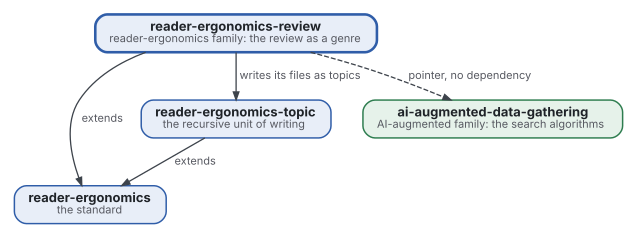
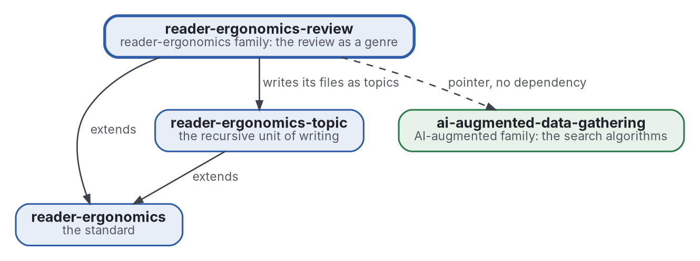

# Revue

[](https://github.com/Tewf/reader-ergonomics-review/actions/workflows/checks.yml)
[](https://tewf.github.io/reader-ergonomics-review/)

La **revue de littérature** comme genre de la famille, écrite en formes avec exemples et vérifications. Elle couvre les cinq étapes, les fichiers qu'une revue tient (cadre, protocole, sources, revue, contre, état de l'art, positionnement, référence, bibliographie), la notation de la littérature grise, le second évaluateur et le flux. Les neuf revues des deux familles en sont les premiers exemples.

Cette page en anglais : [README.md](README.md). Les deux versions suivent le même état.

> **État (2026-11-03) :** un premier jet est écrit : neuf [formes](shapes/README.md) avec un petit exemple, cinq
> [vérifications](checks/README.md) avec leurs tests, une fiche de six [principes](standard.md), et une [revue des
> preuves du genre](evidence/review-genre/README.md) (25 sources, référence B1). Les cinq étapes et le second
> évaluateur sont des conventions, et le disent. Le nom est gardé : le mot du domaine est « revue ». Ce n'est ni une
> norme officielle, ni une étude relue par des pairs, ni un résultat nouveau.
>
> **Comment il est fait :** avec Claude, un assistant IA d'Anthropic, sous la direction du mainteneur, comme
> reader-ergonomics. Les corrections sont bienvenues sous forme d'issues.

## Où il se place



<details>
<summary>Graphviz source</summary>



</details>

- **Il étend [reader-ergonomics](https://github.com/Tewf/reader-ergonomics/blob/65e42472e2d4cbfd994c2a86e95a47e5dc7301ca/standard.md)** (v1.21.0), comme chaque genre, et exécute les vérifications de la norme en CI.
- **Il s'appuie sur [reader-ergonomics-topic](https://github.com/Tewf/reader-ergonomics-topic)** : les fichiers d'une revue sont des topics.
- **Il pointe vers [ai-augmented-data-gathering](https://github.com/Tewf/ai-augmented-data-gathering)** pour les algorithmes qui cherchent, et n'en dépend pas.
- **Il ne pointe que vers le bas.** La carte de la famille est [reader-ergonomics-family](https://github.com/Tewf/reader-ergonomics-family).

## Périmètre

| | Quoi | Pourquoi |
|---|---|---|
| dedans | les cinq étapes d'une revue comme forme, chacune avec son fichier et ce que le fichier doit tenir | un lecteur et un programme doivent savoir où est le résultat de chaque étape |
| dedans | les fichiers d'une revue : cadre, protocole, sources, revue, contre, état de l'art, positionnement, référence, bibliographie | une revue qui garde le dossier contre elle et nomme sa référence peut être vérifiée sur les deux |
| dedans | la notation de la littérature grise : comment une source hors revues est graduée avant de compter | les sources grises font l'essentiel de la pratique dans ce domaine, et ont besoin d'une note comme un article |
| dedans | le second évaluateur et le flux d'une revue, comme formes | un accord et un compte des sources retenues et écartées sont la piste d'audit de la revue |
| dedans | une vérification pour chaque forme | la règle de la norme est que ce qu'un programme peut vérifier, un programme le vérifie |
| dedans | les neuf revues des deux familles, comme premiers exemples | une forme sans exemple rempli n'est pas encore utilisable ; chaque forme en lie deux et un petit exemple à elle |
| plus tard | une mesure d'accord entre deux évaluateurs | la forme d'abord ; la statistique attend les vraies données de deux évaluateurs |
| dehors | les algorithmes de recherche : où chercher et quand s'arrêter | [ai-augmented-data-gathering](https://github.com/Tewf/ai-augmented-data-gathering) |
| dehors | les principes que les formes appliquent | [reader-ergonomics](https://github.com/Tewf/reader-ergonomics), liés et jamais copiés |

## Le premier travail : une revue de littérature

Écrite. Elle a suivi l'ordre d'une revue de thèse et elle est finie parce qu'elle nomme sa référence. Le domaine nomme le genre **revue systématique de littérature**, et **revue de littérature multivocale** quand elle inclut des sources grises ([cadre](evidence/review-genre/frame.md)) ; « revue » est le mot du domaine, le nom reste donc.

### Ce que la revue a trouvé

1. **Les lignes directrices demandent des contenus, pas des fichiers.** PRISMA 2020 demande l'enregistrement, le soutien, les conflits d'intérêts et la disponibilité des données ; les neuf revues n'en déclarent aucun. Contre, positionnement et référence ne sont dans aucune ligne directrice ([revue, filon 1](evidence/review-genre/review.md)).
2. **Le seuil de 10 sur 20 est un exemple.** Garousi 2019 l'offre comme ce qu'on pourrait fixer, et ne rapporte aucun accord entre personnes. Aucune étude de la fiabilité des notes grises n'a été trouvée.
3. **Un second lecteur est mesuré pour le tri, pas pour la note.** Un seul relecteur a manqué en moyenne 8 % des rapports éligibles, une paire 0 à 1 % (Edwards 2002, secondaire). Aucune source ne note deux fois une qualité.
4. **Les chaînes de recherche trouvent une minorité.** Seulement 30 % des sources d'une revue venaient des recherches de son protocole, 51 % de la boule de neige (Greenhalgh 2005, secondaire). Le relevé des chaînes est donc aussi le relevé de sa limite.
5. **Aucun programme ne vérifie le rapport d'une revue.** Le vérificateur de l'organisme qui fixe la norme est en développement ([PRISMA Executive 2026](evidence/bibliography.md)).

### La référence

**B1** est les neuf revues de la famille AI-augmented et du sujet project-method, telles qu'elles sont à leurs commits épinglés ([référence](evidence/review-genre/baseline.md)). Les vérifications d'ici sont le premier programme à les lire.

### Ce que les vérifications signalent sur les neuf

Exécutées en lecture seule avec `python3 checks/audit.py` le 2026-11-03 : 2 erreurs et 25 avertissements en tout.

| Vérification | Sur les neuf | Ce qu'elle signale |
|---|---|---|
| `review-files` | 0 | chacune a les huit fichiers et une bibliographie partagée |
| `grey-subtotals` | 0 | chaque ligne grise s'additionne, dans ses maxima |
| `second-rater` | 0 | là où deux évaluateurs existent, l'accord est rapporté |
| `search-record` | 2 erreurs, 1 avertissement | une revue n'a pas de tableau de chaînes ni de règle d'arrêt ; une ligne grise n'a pas de décompte |
| `review-numbers` | 24 avertissements | un chiffre sans clé, ou sans lieu ni le mot secondaire ; certains sont les décomptes de la revue elle-même |

Les 24 autres revues de la famille ont été écrites au contrat antérieur du 2026-10-29. Elles tirent 411 erreurs et 705 avertissements, surtout de mise en page : notes grises séparées de leur total, tableaux de chaînes sans colonne de décompte.

## Questions auxquelles la revue doit répondre

- **Les fichiers.** Quels fichiers les lignes directrices exigent-elles que les neuf revues n'ont pas, et lesquels les neuf tiennent-elles sans que les lignes directrices les demandent ?
- **La note grise.** Qu'est-ce qui gradue une source grise dans les lignes directrices, et quelle note les sources de la famille recevraient-elles ?
- **Le second évaluateur.** Que coûte un second évaluateur, et que repère-t-il qu'un programme ne repère pas ?
- **Les vérifications.** Quelles parties d'une revue un programme peut-il décider, et lesquelles restent un jugement ?

Les réponses sont dans le [positionnement](evidence/review-genre/position.md).

## Vérifier

```sh
git clone https://github.com/Tewf/reader-ergonomics
python3 reader-ergonomics/checks/run.py chemin/vers/ce/depot
```

Pour lire les revues d'un autre dépôt sans les modifier : `python3 checks/audit.py chemin/vers/le/depot`.

La CI exécute les mêmes vérifications à chaque push, et une exécution échoue à la première erreur
([checks.yml](https://github.com/Tewf/reader-ergonomics-review/blob/master/.github/workflows/checks.yml)). Chaque push sur
master construit aussi le site, [tewf.github.io/reader-ergonomics-review](https://tewf.github.io/reader-ergonomics-review/)
([pages.yml](https://github.com/Tewf/reader-ergonomics-review/blob/master/.github/workflows/pages.yml)).

## Contenu

| Partie | Résumé |
|---|---|
| [standard](standard.md) | la fiche : lire d'abord la norme, puis les six principes avec leurs niveaux de preuve |
| [shapes](shapes/README.md) | les neuf fichiers d'une revue comme squelettes, chacun avec un exemple rempli |
| [principles](principles/README.md) | ce que le genre ajoute à la norme : structure et relevé |
| [checks](checks/README.md) | les cinq vérifications, leurs tests, et l'audit d'un autre dépôt |
| [evidence](evidence/README.md) | la revue des preuves du genre, 25 sources, et la bibliographie |
| [decisions](decisions/) | une fiche par choix qui façonne ce dépôt, chacune ouvrant sur la décision en une phrase |

## Licence

Code sous [Apache License 2.0](LICENSE) ; prose sous [CC BY 4.0](LICENSES/CC-BY-4.0.txt). Réutilisez-le comme vous le
souhaitez, en créditant ce dépôt ; [CITATION.cff](CITATION.cff) donne une citation si besoin.
