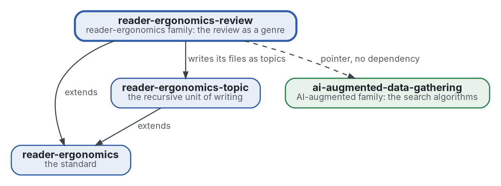

# Revue

[](https://github.com/Tewf/reader-ergonomics-review/actions/workflows/checks.yml)
[](https://tewf.github.io/reader-ergonomics-review/)

La **revue de littérature** comme genre de la famille, écrite en formes avec exemples et vérifications. Elle couvre les cinq étapes, les fichiers qu'une revue tient (cadre, protocole, sources, revue, contre, état de l'art, positionnement, référence, bibliographie), la notation de la littérature grise, le second évaluateur et le flux. Les neuf revues des deux familles en sont les premiers exemples.

Cette page en anglais : [README.md](README.md). Les deux versions suivent le même état.

> **État (2026-11-03) :** mis en place ; rien n'est encore écrit au-delà du périmètre. Le premier travail est une revue
> de littérature, non commencée. Le nom est provisoire jusqu'à ce que la première étape de cette revue dise comment le
> domaine nomme la chose. Ce n'est ni une norme officielle, ni une étude relue par des pairs, ni un résultat nouveau.
>
> **Comment il est fait :** avec Claude, un assistant IA d'Anthropic, sous la direction du mainteneur, comme
> reader-ergonomics. Les corrections sont bienvenues sous forme d'issues.

## Où il se place


<details>
<summary>Graphviz source</summary>



</details>

- **Il étend [reader-ergonomics](https://github.com/Tewf/reader-ergonomics/blob/4f99372093729dacf982e9174e94f6b8793c513d/standard.md)** (v1.20.0), comme chaque genre, et exécute les vérifications de la norme en CI.
- **Il s'appuie sur [reader-ergonomics-topic](https://github.com/Tewf/reader-ergonomics-topic)** : les fichiers d'une revue sont des topics.
- **Il pointe vers [ai-augmented-data-gathering](https://github.com/Tewf/ai-augmented-data-gathering)** pour les algorithmes qui cherchent, et n'en dépend pas.
- **Il ne pointe que vers le bas.** La carte de la famille est [reader-ergonomics-family](https://github.com/Tewf/reader-ergonomics-family).

## Périmètre

| | Quoi | Pourquoi |
|---|---|---|
| dedans | les cinq étapes d'une revue comme forme, chacune avec son fichier et ce que le fichier doit tenir | un lecteur et un programme doivent savoir où est le résultat de chaque étape |
| dedans | les fichiers d'une revue : cadre, protocole, sources, revue, contre, état de l'art, positionnement, référence, bibliographie | une revue qui garde le dossier contre elle et nomme sa référence peut être vérifiée sur les deux |
| dedans | la notation de la littérature grise : comment une source hors revues est graduée avant de compter | les sources grises font l'essentiel de la pratique dans ce domaine, et ont besoin d'une note comme un article |
| dedans | le second évaluateur et le flux d'une revue, comme formes | un accord et un compte des sources retenues et écartées sont la piste d'audit de la revue |
| dedans | une vérification pour chaque forme | la règle de la norme est que ce qu'un programme peut vérifier, un programme le vérifie |
| dedans | les neuf revues des deux familles, comme premiers exemples | une forme sans exemple rempli n'est pas encore utilisable |
| plus tard | une mesure d'accord entre deux évaluateurs | la forme d'abord ; la statistique attend les vraies données de deux évaluateurs |
| dehors | les algorithmes de recherche : où chercher et quand s'arrêter | [ai-augmented-data-gathering](https://github.com/Tewf/ai-augmented-data-gathering) |
| dehors | les principes que les formes appliquent | [reader-ergonomics](https://github.com/Tewf/reader-ergonomics), liés et jamais copiés |

## Le premier travail : une revue de littérature

Non commencée. Elle suit l'ordre d'une revue de thèse, et elle est finie quand elle peut nommer la référence.

1. **Cadrer :** le problème en une phrase, et comment chaque domaine le nomme. Pistes à vérifier : la revue de littérature multivocale (Garousi 2019), les lignes directrices de rapport des revues systématiques (PRISMA) et celles de la boule de neige (Wohlin 2014). Le dépôt peut être renommé alors.
2. **Revue :** chaque nom, cherché par son nom académique, son acronyme et son auteur ; les synthèses d'abord.
   - les lignes directrices des revues systématiques, multivocales et rapides, par leur nom académique et leur acronyme, les synthèses d'abord ;
   - comment une source grise est graduée dans les lignes directrices qui le font, et ce que la note décide ;
   - les listes de contrôle de rapport et tout programme qui en vérifie une, trouvés sous le nom des auteurs avant d'écrire qu'ils manquent.
3. **État de l'art, et le dossier contre.**
4. **Positionnement :** ce que ce dépôt demande et que le domaine ne répond pas déjà.
5. **Référence :** les fichiers des neuf revues existantes tels qu'ils sont, comparés à ce que les lignes directrices demandent à une revue de rapporter, ce que la revue du genre listera.

## Questions auxquelles la revue doit répondre

- **Les fichiers.** Quels fichiers les lignes directrices exigent-elles que les neuf revues n'ont pas, et lesquels les neuf tiennent-elles sans que les lignes directrices les demandent ?
- **La note grise.** Qu'est-ce qui gradue une source grise dans les lignes directrices, et quelle note les sources de la famille recevraient-elles ?
- **Le second évaluateur.** Que coûte un second évaluateur, et que repère-t-il qu'un programme ne repère pas ?
- **Les vérifications.** Quelles parties d'une revue un programme peut-il décider, et lesquelles restent un jugement ?

## Vérifier

```sh
git clone https://github.com/Tewf/reader-ergonomics
python3 reader-ergonomics/checks/run.py chemin/vers/ce/depot
```

La CI exécute les mêmes vérifications à chaque push, et une exécution échoue à la première erreur
([checks.yml](https://github.com/Tewf/reader-ergonomics-review/blob/master/.github/workflows/checks.yml)). Chaque push sur
master construit aussi le site, [tewf.github.io/reader-ergonomics-review](https://tewf.github.io/reader-ergonomics-review/)
([pages.yml](https://github.com/Tewf/reader-ergonomics-review/blob/master/.github/workflows/pages.yml)).

## Contenu

| Partie | Résumé |
|---|---|
| [decisions](decisions/) | une fiche par choix qui façonne ce dépôt, chacune ouvrant sur la décision en une phrase |

## Licence

Code sous [Apache License 2.0](LICENSE) ; prose sous [CC BY 4.0](LICENSES/CC-BY-4.0.txt). Réutilisez-le comme vous le
souhaitez, en créditant ce dépôt ; [CITATION.cff](CITATION.cff) donne une citation si besoin.
