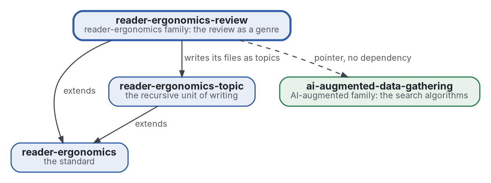

# Review

[](https://github.com/Tewf/reader-ergonomics-review/actions/workflows/checks.yml)
[](https://tewf.github.io/reader-ergonomics-review/)

The **literature review** as a genre of the family, written as shapes with examples and checks. It covers the five steps, the files a review keeps (frame, protocol, sources, review, against, state of the art, position, baseline, references), the grey scoring, the second rater and the flow. The nine reviews of the two families are its first examples.

This page in French: [README.fr.md](README.fr.md).

> **Status (2026-11-03):** set up; nothing is written yet beyond the scope. The first job is a literature review, not
> started. The name is provisional until that review's first step says what the field calls this. It is not an
> official standard, not a peer-reviewed study and not a new result.
>
> **How it is made:** with Claude, an AI assistant by Anthropic, under the maintainer's direction, the way
> reader-ergonomics was made. Corrections are welcome as issues.

## Where it sits


<details>
<summary>Graphviz source</summary>



</details>

- **It extends [reader-ergonomics](https://github.com/Tewf/reader-ergonomics/blob/4f99372093729dacf982e9174e94f6b8793c513d/standard.md)** (v1.20.0), as each genre does, and runs the standard's checks in CI.
- **It builds on [reader-ergonomics-topic](https://github.com/Tewf/reader-ergonomics-topic)**: a review's files are topics.
- **It points to [ai-augmented-data-gathering](https://github.com/Tewf/ai-augmented-data-gathering)** for the algorithms that search, and does not depend on it.
- **It links down only.** The family's map is [reader-ergonomics-family](https://github.com/Tewf/reader-ergonomics-family).

## Scope

| | What | Why |
|---|---|---|
| in | the five steps of a review as a shape, each with its file and what the file must hold | a reader and a program need to know where each step's result is |
| in | the files of a review: frame, protocol, sources, review, against, state of the art, position, baseline, references | a review that keeps the case against, and names its baseline, can be checked for both |
| in | the grey scoring: how a source outside journals is graded before it counts | grey sources are most of the practice in this field, and need a grade as a paper does |
| in | the second rater and the flow of a review, as shapes | an agreement and a count of sources in and out are the review's audit trail |
| in | a check for each shape | the standard's rule is that what a program can check, a program checks |
| in | the nine reviews of the two families, as the first examples | a shape without a filled example is not yet usable |
| later | a measure of agreement between two raters | the shape comes first; the statistic waits for two raters' real data |
| out | the search algorithms: where to look and when to stop | [ai-augmented-data-gathering](https://github.com/Tewf/ai-augmented-data-gathering) |
| out | the principles the shapes apply | [reader-ergonomics](https://github.com/Tewf/reader-ergonomics), linked and never copied |

## The first job: a literature review

Not started. It follows the order of a thesis review, and it is finished when it can name the baseline.

1. **Frame:** the problem in one sentence, and what each field calls it. Leads to verify: the multivocal literature review (Garousi 2019), the systematic-review reporting guidelines (PRISMA) and snowballing guidelines (Wohlin 2014). The repository may be renamed then.
2. **Review:** each name, searched by its academic name, its acronym and its author; surveys first.
   - guidelines for systematic, multivocal and rapid reviews, by their academic names and their acronyms, surveys first;
   - how a grey source is graded in the guidelines that do, and what the grade decides;
   - reporting checklists and any program that checks one, found under its authors' names before anything is written as missing.
3. **State of the art, and the case against.**
4. **Position:** what this repository asks that the field does not already answer.
5. **Baseline:** the existing nine reviews' files as they stand, compared with what the guidelines ask a review to report, which the review of the genre will list.

## Questions the review must answer

- **The files.** Which files do the guidelines require that the nine reviews lack, and which do the nine keep that the guidelines do not ask for?
- **The grey score.** What grades a grey source in the guidelines, and what grade would the family's own sources get?
- **The second rater.** What does a second rater cost, and what does it catch that a program cannot?
- **The checks.** Which parts of a review can a program decide, and which stay a judgment?

## Check it

```sh
git clone https://github.com/Tewf/reader-ergonomics
python3 reader-ergonomics/checks/run.py path/to/this/repository
```

CI runs the same checks on every push, and a run fails on any error
([checks.yml](https://github.com/Tewf/reader-ergonomics-review/blob/master/.github/workflows/checks.yml)). Every push to
master also renders the site, [tewf.github.io/reader-ergonomics-review](https://tewf.github.io/reader-ergonomics-review/)
([pages.yml](https://github.com/Tewf/reader-ergonomics-review/blob/master/.github/workflows/pages.yml)).

## Contents

| Part | Summary |
|---|---|
| [decisions](decisions/) | one record per choice that shapes this repository, each opening with the decision in one sentence |

## Licence

Code under the [Apache License 2.0](LICENSE); prose under [CC BY 4.0](LICENSES/CC-BY-4.0.txt). Reuse it as you wish,
with credit to this repository; [CITATION.cff](CITATION.cff) gives a citation if you need one.
