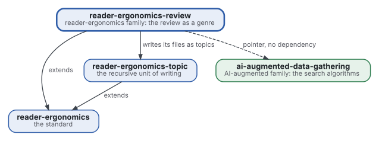
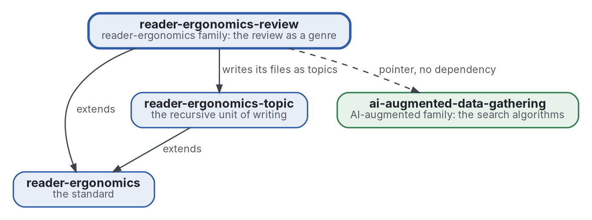

# Review

[](https://github.com/Tewf/reader-ergonomics-review/actions/workflows/checks.yml)
[](https://tewf.github.io/reader-ergonomics-review/)

The **literature review** as a genre of the family, written as shapes with examples and checks. It covers the five steps, the files a review keeps (frame, protocol, sources, review, against, state of the art, position, baseline, references), the grey scoring, the second rater and the flow. The nine reviews of the two families are its first examples.

This page in French: [README.fr.md](README.fr.md).

> **Status (2026-11-03):** a first pass is written: nine [shapes](shapes/README.md) with a small example, five
> [checks](checks/README.md) with tests, a card of six [principles](standard.md), and a [review of the genre's own
> evidence](evidence/review-genre/README.md) (25 sources, baseline B1). The five steps and the second rater are
> conventions, and say so. The name is kept: the field's own word is review. It is not an official standard, not a
> peer-reviewed study and not a new result.
>
> **How it is made:** with Claude, an AI assistant by Anthropic, under the maintainer's direction, the way
> reader-ergonomics was made. Corrections are welcome as issues.

## Where it sits



<details>
<summary>Graphviz source</summary>



</details>

- **It extends [reader-ergonomics](https://github.com/Tewf/reader-ergonomics/blob/4f99372093729dacf982e9174e94f6b8793c513d/standard.md)** (v1.20.0), as each genre does, and runs the standard's checks in CI.
- **It builds on [reader-ergonomics-topic](https://github.com/Tewf/reader-ergonomics-topic)**: a review's files are topics.
- **It points to [ai-augmented-data-gathering](https://github.com/Tewf/ai-augmented-data-gathering)** for the algorithms that search, and does not depend on it.
- **It links down only.** The family's map is [reader-ergonomics-family](https://github.com/Tewf/reader-ergonomics-family).

## Scope

| | What | Why |
|---|---|---|
| in | the five steps of a review as a shape, each with its file and what the file must hold | a reader and a program need to know where each step's result is |
| in | the files of a review: frame, protocol, sources, review, against, state of the art, position, baseline, references | a review that keeps the case against, and names its baseline, can be checked for both |
| in | the grey scoring: how a source outside journals is graded before it counts | grey sources are most of the practice in this field, and need a grade as a paper does |
| in | the second rater and the flow of a review, as shapes | an agreement and a count of sources in and out are the review's audit trail |
| in | a check for each shape | the standard's rule is that what a program can check, a program checks |
| in | the nine reviews of the two families, as the first examples | a shape without a filled example is not yet usable; each shape links two of them and a small example of its own |
| later | a measure of agreement between two raters | the shape comes first; the statistic waits for two raters' real data |
| out | the search algorithms: where to look and when to stop | [ai-augmented-data-gathering](https://github.com/Tewf/ai-augmented-data-gathering) |
| out | the principles the shapes apply | [reader-ergonomics](https://github.com/Tewf/reader-ergonomics), linked and never copied |

## The first job: a literature review

Written. It followed the order of a thesis review and is finished because it names its baseline. The field's name for the genre is **systematic literature review**, and **multivocal literature review** when it includes grey sources ([frame](evidence/review-genre/frame.md)); "review" is the field's own word, so the name stays.

### What the review found

1. **The guidelines ask for contents, not files.** PRISMA 2020 asks for registration, support, competing interests and availability of data; the nine reviews state none of them. Against, position and baseline are in no guideline ([review, strand 1](evidence/review-genre/review.md)).
2. **The threshold of 10 of 20 is an example.** Garousi 2019 offers it as what one could set, and reports no agreement between persons. No study of the reliability of grey scores was found.
3. **A second reader is measured for screening, not for scoring.** Single reviewers missed 8% of eligible reports on average, pairs 0 to 1% (Edwards 2002, secondary); no source rates a quality score twice.
4. **Searches by string find a minority.** Only 30% of one review's sources came from its protocol's searches, 51% from snowballing (Greenhalgh 2005, secondary), so a record of strings is also a record of its limit.
5. **No program checks a review's report.** The standard-setting body's own checker is in development ([PRISMA Executive 2026](evidence/bibliography.md)).

### The baseline

**B1** is the nine reviews of the AI-augmented family and the project-method topic, as they stand at their pinned commits ([baseline](evidence/review-genre/baseline.md)). The checks here are the first program to read them.

### What the checks flag on the nine

Run read-only with `python3 checks/audit.py` on 2026-11-03: 2 errors and 25 warnings in all.

| Check | On the nine | What it flags |
|---|---|---|
| `review-files` | 0 | each has the eight files and a shared bibliography |
| `grey-subtotals` | 0 | every grey row adds up, within its maxima |
| `second-rater` | 0 | where two raters exist, the agreement is reported |
| `search-record` | 2 errors, 1 warning | one review has no table of strings and no stopping rule; one grey row has no count |
| `review-numbers` | 24 warnings | a figure with no key, or no place or word secondary; some are the review's own counts |

The other 24 reviews of the family were written to the earlier contract of 2026-10-29. They draw 411 errors and 705 warnings, mostly layout: grey scores split from their totals, tables of strings with no count column.

## Check it

```sh
git clone https://github.com/Tewf/reader-ergonomics
python3 reader-ergonomics/checks/run.py path/to/this/repository
```

To read another repository's reviews without changing them: `python3 checks/audit.py path/to/repository`.

CI runs the same checks on every push, and a run fails on any error
([checks.yml](https://github.com/Tewf/reader-ergonomics-review/blob/master/.github/workflows/checks.yml)). Every push to
master also renders the site, [tewf.github.io/reader-ergonomics-review](https://tewf.github.io/reader-ergonomics-review/)
([pages.yml](https://github.com/Tewf/reader-ergonomics-review/blob/master/.github/workflows/pages.yml)).

## Contents

| Part | Summary |
|---|---|
| [standard](standard.md) | the card: read the standard first, then the six principles with their grades |
| [shapes](shapes/README.md) | the nine files of a review as skeletons, each with a filled example |
| [principles](principles/README.md) | what the genre adds to the standard: structure and record |
| [checks](checks/README.md) | the five checks, their tests, and the audit of another repository |
| [evidence](evidence/README.md) | the review of the genre's own evidence, 25 sources, and the bibliography |
| [decisions](decisions/) | one record per choice that shapes this repository, each opening with the decision in one sentence |

## Licence

Code under the [Apache License 2.0](LICENSE); prose under [CC BY 4.0](LICENSES/CC-BY-4.0.txt). Reuse it as you wish,
with credit to this repository; [CITATION.cff](CITATION.cff) gives a citation if you need one.
