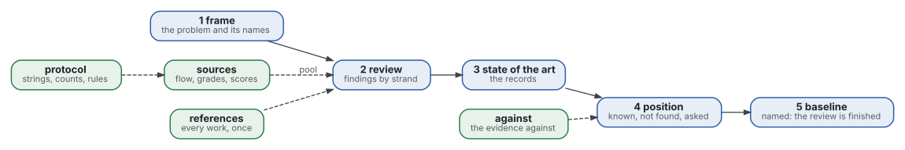

# Shapes

A **shape** is the fixed skeleton of one kind of document: every document of that kind has the same parts in the same order. These are the shapes of the files of a literature review. The general shapes (note, folder README, report, commit, decision record) and the reasons for shapes are in [reader-ergonomics](https://github.com/Tewf/reader-ergonomics/blob/65e42472e2d4cbfd994c2a86e95a47e5dc7301ca/shapes/README.md).

```dot
digraph review_files {
  graph [rankdir=LR, nodesep=0.35, ranksep=0.5, bgcolor="white", pad=0.2, fontname="Inter"];
  node  [shape=box, style="rounded,filled", fontname="Inter", fontsize=13, margin="0.2,0.1", penwidth=1.5, fontcolor="#1F2328"];
  edge  [fontname="Inter", fontsize=11, color="#3D434B", fontcolor="#55575F", penwidth=1.3, arrowsize=0.8];
  F [label=<<b>1 frame</b><br/><font point-size="11" color="#55575F">the problem and its names</font>>, fillcolor="#E8EEF8", color="#2F5DA8"];
  R [label=<<b>2 review</b><br/><font point-size="11" color="#55575F">findings by strand</font>>, fillcolor="#E8EEF8", color="#2F5DA8"];
  S [label=<<b>3 state of the art</b><br/><font point-size="11" color="#55575F">the records</font>>, fillcolor="#E8EEF8", color="#2F5DA8"];
  P [label=<<b>4 position</b><br/><font point-size="11" color="#55575F">known, not found, asked</font>>, fillcolor="#E8EEF8", color="#2F5DA8"];
  B [label=<<b>5 baseline</b><br/><font point-size="11" color="#55575F">named: the review is finished</font>>, fillcolor="#E8EEF8", color="#2F5DA8"];
  PR [label=<<b>protocol</b><br/><font point-size="11" color="#55575F">strings, counts, rules</font>>, fillcolor="#E6F2EA", color="#2E7D4F"];
  SO [label=<<b>sources</b><br/><font point-size="11" color="#55575F">flow, grades, scores</font>>, fillcolor="#E6F2EA", color="#2E7D4F"];
  A [label=<<b>against</b><br/><font point-size="11" color="#55575F">the evidence against</font>>, fillcolor="#E6F2EA", color="#2E7D4F"];
  RF [label=<<b>references</b><br/><font point-size="11" color="#55575F">every work, once</font>>, fillcolor="#E6F2EA", color="#2E7D4F"];
  F -> R -> S -> P -> B;
  PR -> SO [style=dashed];
  SO -> R [style=dashed, label=" pool"];
  A -> P [style=dashed];
  RF -> R [style=dashed];
}
```

Graphviz source

Blue is a step of the method and green a file that records what the steps rest on. Each step writes one file; the other four are kept beside them.

## Contents

| Shape | For |
|---|---|
| [frame.md](frame.md) | step 1: the problem in one sentence, the field's names beside the practitioners', the sub-questions |
| [protocol.md](protocol.md) | how the pool was built: why grey sources, every string with its count, the stopping rule, the selection, the score, what was not searched |
| [sources.md](sources.md) | the pool: the flow in and out, each formal source with its grade, each grey source with its eight subtotals and total |
| [review.md](review.md) | step 2: the findings by strand, each with its figure, source and place |
| [against.md](against.md) | the evidence against the claim, and the disagreements |
| [state-of-the-art.md](state-of-the-art.md) | step 3: for each question, the best evidence apart from the practice most adopted |
| [position.md](position.md) | step 4: what is known, what was not found, the questions answered, what the repository asks |
| [baseline.md](baseline.md) | step 5: the named baseline, how it compares with what the review found, how it is measured |
| [references.md](references.md) | every work cited, once, with a stable link |

Each shape links a filled example, [one small review of our own](examples/second-reader/README.md) and the same file of two reviews of the family at their pinned commits. The family's reviews predate the shapes and carry no Shape line. A file declares its shape with a `**Shape:**` line. The labels and headings of a skeleton are written in that exact form, because the checks read them.

## Choosing a shape

- One file, one shape. A text that needs two shapes is two files ([one mode per document](https://github.com/Tewf/reader-ergonomics/blob/65e42472e2d4cbfd994c2a86e95a47e5dc7301ca/principles/document/one-mode-per-document.md)).
- Write the files in the order of the five steps; the [files principle](../principles/structure/the-nine-files.md) says why.
